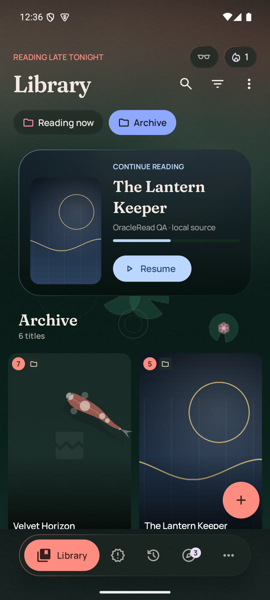
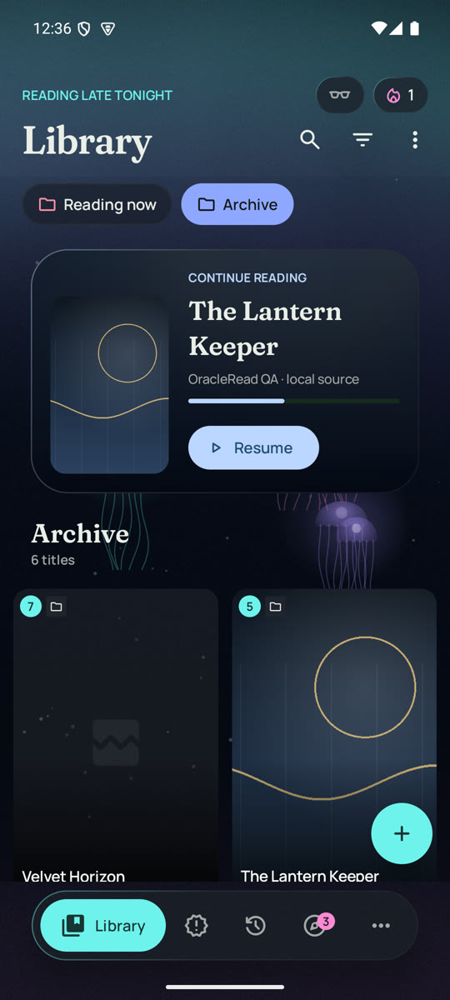
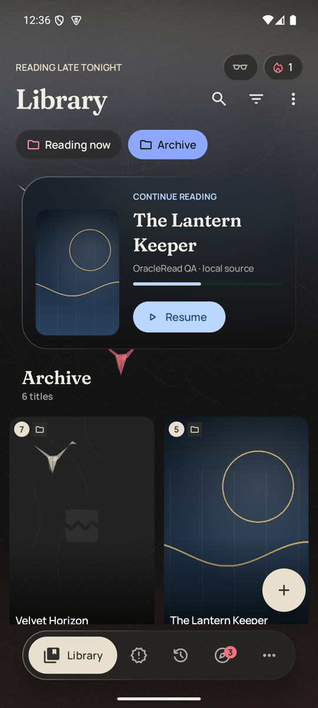
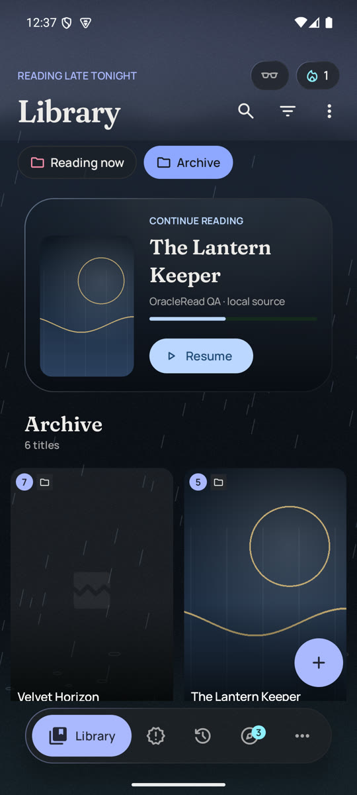
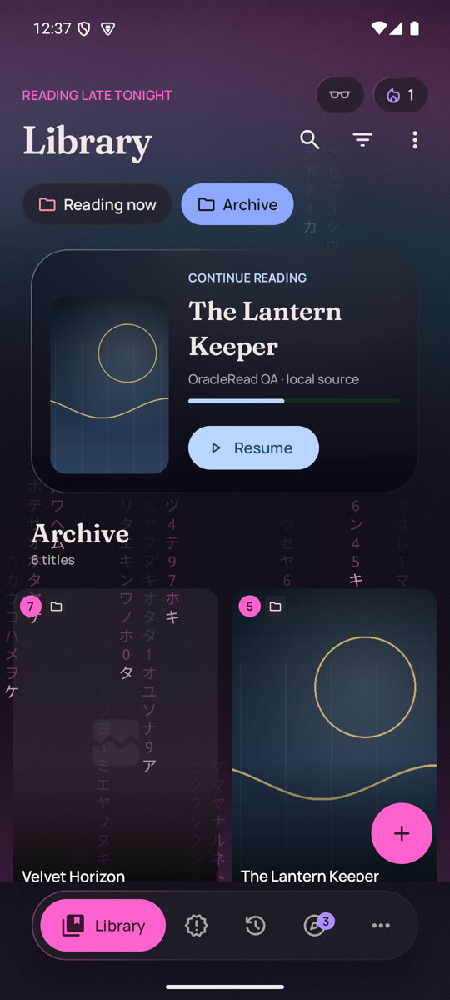
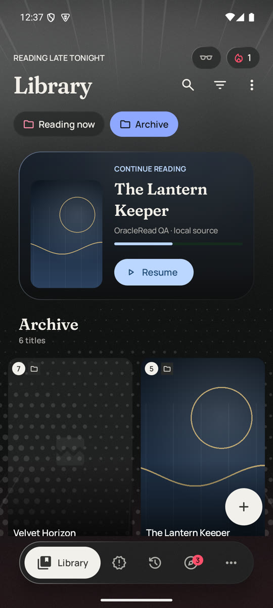
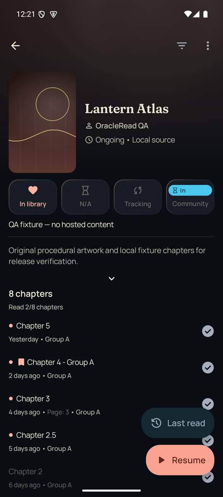
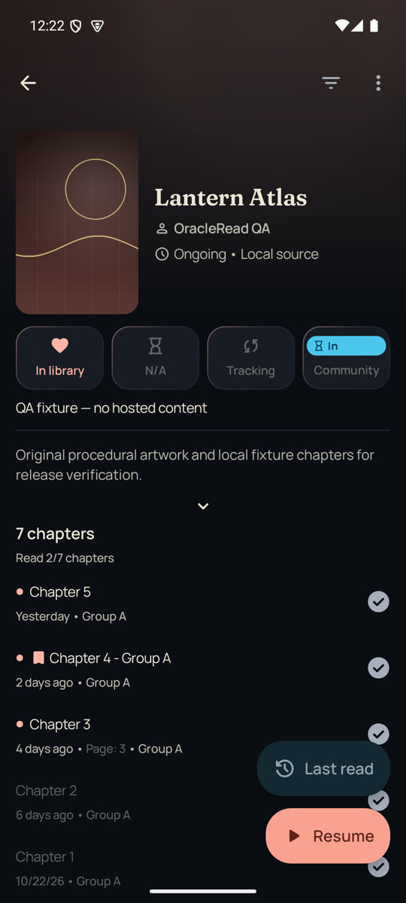
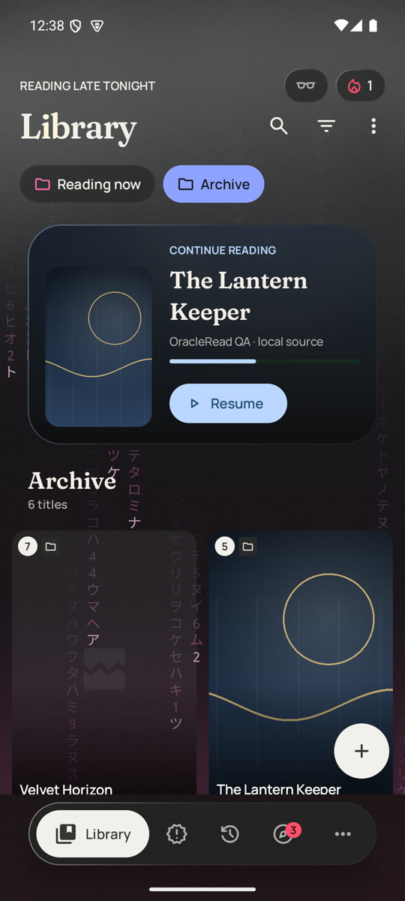
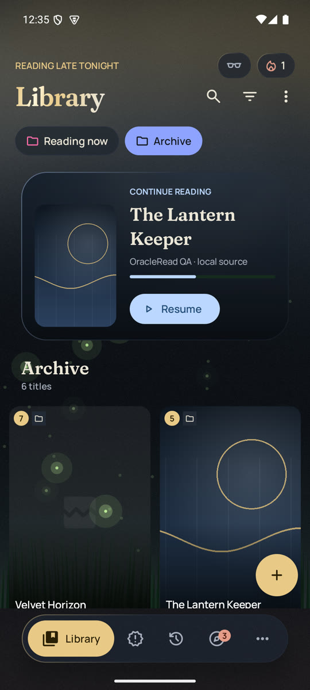

# OracleRead

OracleRead is a free and open source community manga reader for Android 8.0 and above.

OracleRead is a community-driven fork of Mihon focused on providing a clean, stable, and modern manga reading experience.

Project lineage:

Tachiyomi -> Mihon -> OracleRead

## What makes OracleRead different

OracleRead has a **cinematic, immersive** look of its own:

- the cover art is the star of every screen
- a dark ink-night canvas with lantern-gold accents
- serif title cards
- glass controls
- a floating navigation dock
- a continue-reading hero in the library
- manga pages set on their own blurred cover art

The design system is documented in [DESIGN.md](DESIGN.md) and the product principles in [PRODUCT.md](PRODUCT.md).

OracleRead also adds:

- a Community space and OracleRead accounts (in progress, coming in a future update)
- reader auto-retry
- a reading streak
- pinned manga
- folder styles with ambient backgrounds (or none)
- source shortcuts
- hiding decimal and duplicate chapters
- a Last read button above Resume
- themes with background effects of their own
- a compact navigation mode

It stays in sync with Mihon; the latest sync is described in [docs/sync-notes.md](docs/sync-notes.md).

## What's new in 1.4.2

Full notes: [docs/releases/2026-10-29-v1.4.2.md](docs/releases/2026-10-29-v1.4.2.md).

- **Six new themes**, each with its own colors and background effect: Koi Garden, Abyssal Bloom, Paper Cranes,
  Tempest, Neon Alley and Screentone.
- **Eight new folder backgrounds**: Koi Pond, Jellyfish, Paper Cranes, Thunderstorm, Glyph Rain, Screentone, Meteor
  Shower and Fireflies. Tap the selected one again to turn it off.
- **Last read** above Resume opens the chapter you read most recently.
- **Reading skips hidden chapters**: with decimal or duplicate chapters hidden, next and previous chapter go past them.

| Koi Garden | Abyssal Bloom | Paper Cranes | Tempest | Neon Alley | Screentone |
|---|---|---|---|---|---|
|  |  |  |  |  |  |

| Last read + Resume | Hidden chapters | Glyph Rain | Fireflies |
|---|---|---|---|
|  |  |  |  |

### Previous releases

- 1.4.1: hide duplicate chapters, the greeting row, folder background None plus four designs, a smoother home.
  [Notes](docs/releases/2026-10-28-v1.4.1.md).
- 1.4.0: synced with Mihon and introduced the cinematic redesign. See [CHANGELOG.md](CHANGELOG.md).

## Extension Repository

OracleRead includes the Keiyoushi and Yūzōnō extension repositories by default:

<https://github.com/keiyoushi/extensions>

<https://github.com/yuzono/manga-repo>

## Credits

OracleRead is built upon the Mihon open-source project.

Special thanks to:

- Mihon Open Source Project
- Original Tachiyomi contributors
- Extension developers
- Open source contributors

Links:

- Mihon GitHub: <https://github.com/mihonapp/mihon>
- OracleRead Repository: <https://github.com/kenje24/OracleRead.git>

## Legal Disclaimer

OracleRead does not host, store, or distribute any content.

All content is provided by third-party sources and extensions.

OracleRead is an independent open-source project and is not affiliated with content providers.

## License

Copyright 2015 Javier Tomas

Copyright 2024 Mihon Open Source Project

Licensed under the Apache License, Version 2.0 (the "License");
you may not use this file except in compliance with the License.
You may obtain a copy of the License at

<http://www.apache.org/licenses/LICENSE-2.0>

Unless required by applicable law or agreed to in writing, software
distributed under the License is distributed on an "AS IS" BASIS,
WITHOUT WARRANTIES OR CONDITIONS OF ANY KIND, either express or implied.
See the License for the specific language governing permissions and
limitations under the License.
