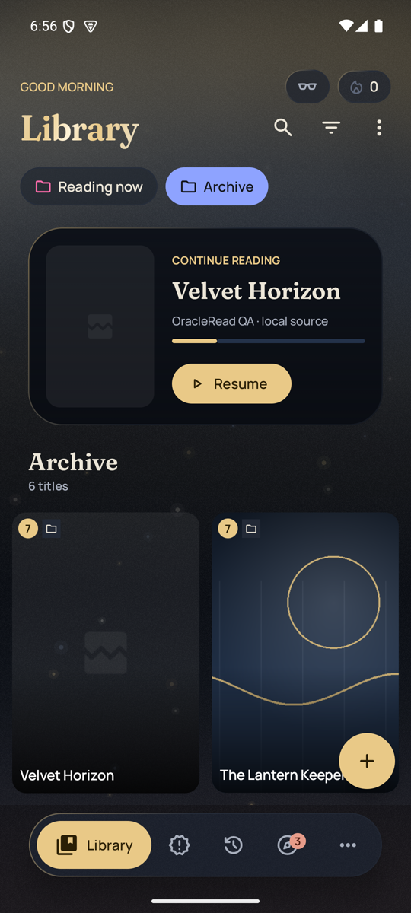
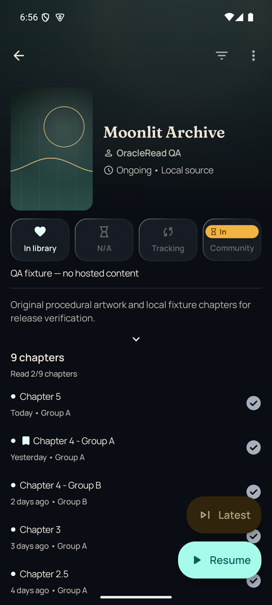
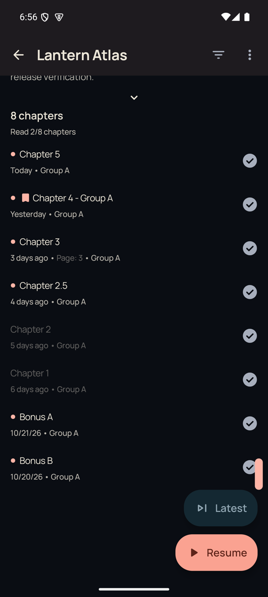
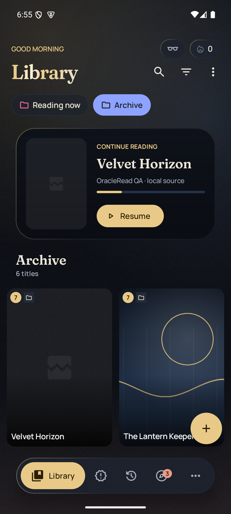
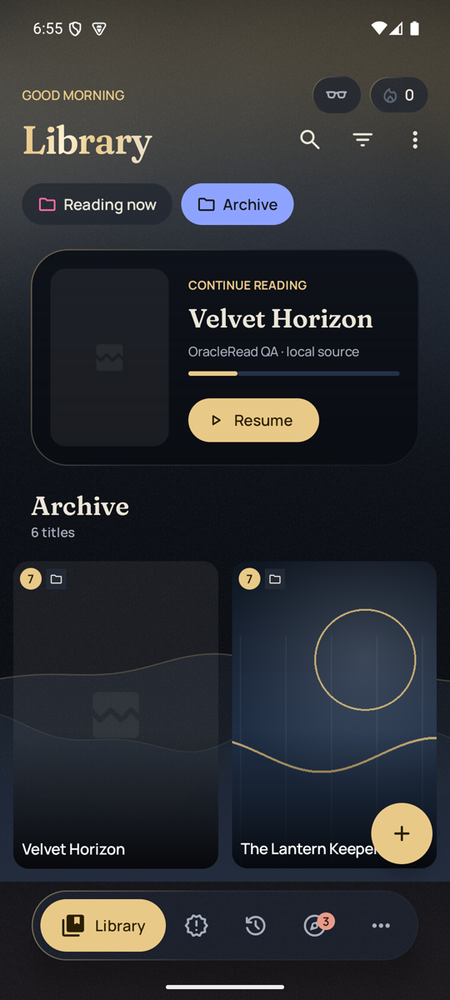
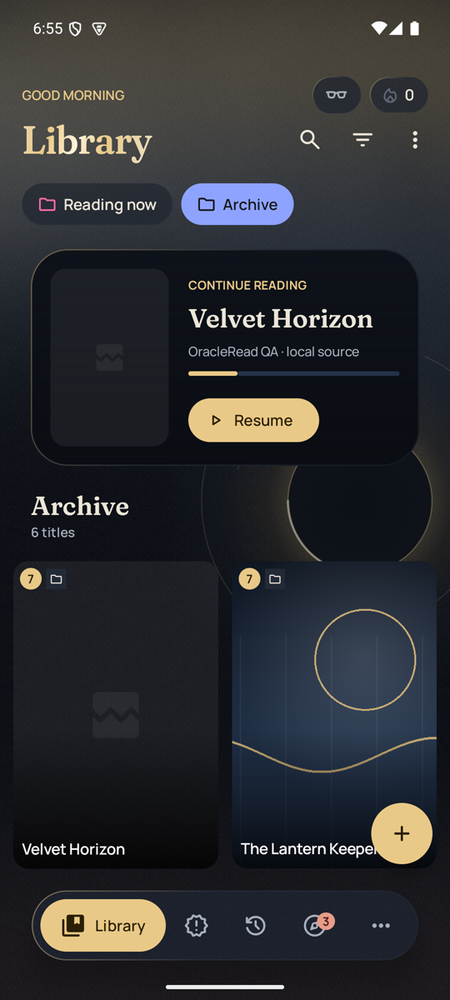
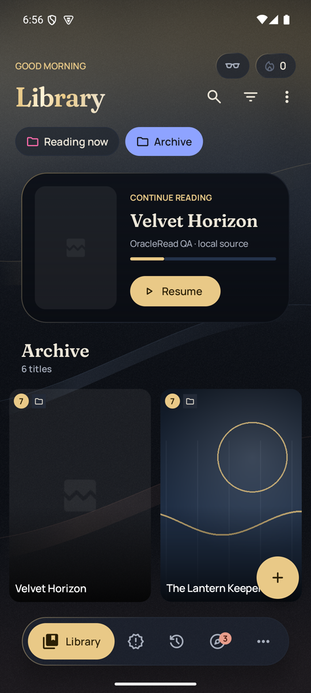

# OracleRead 1.4.1 (2026-10-28)

A focused update on top of 1.4.0: tidier chapter lists, a faster way to the newest chapter, a cleaner library header,
more folder backgrounds (or none at all), and a lighter, smoother home screen.

**Updating:** 1.4.1 is signed with the same OracleRead key as 1.4.0, so it installs over 1.4.0 and keeps your library.
Coming from 1.3.x, follow the backup and restore steps in the 1.4.0 release notes first.

## What's new

| | |
|---|---|
| **Hide duplicate chapters** | When a source lists the same chapter from several groups, show one copy of each chapter number. The copy you're reading, have read, bookmarked or downloaded is the one kept. Nothing is deleted, chapters without a number (extras, specials) are never hidden, and decimal chapters like 12.5 stay separate. Turn it on per manga from the chapter menu (⋮ → Hide duplicate chapters), or for every manga in Settings → Library. Resume and the reader use the same list. |
| **Latest** | A new button above Resume on each manga's page opens the newest chapter as the source lists it, whatever the list's sorting, filters or read state. Resume works exactly as before. |
| **Greeting row** | Incognito and the reading streak moved to the right of "Good morning / afternoon / evening", so the Library title has the row to itself. |
| **Folder backgrounds** | New **None** option (no background, and the home aurora holds still behind that folder) plus four new designs: **Ink Tide**, **Constellations**, **Eclipse Halo** and **Silk Ribbons**. Long-press a folder tab to change it. Existing folder styles are kept. |
| **Smoother home** | Ambient motion now shares one 30-per-second clock and pauses when the screen is hidden, the aurora shader does less work, and animations no longer rebuild the library on every frame. |

## Screenshots

| Library header | Latest above Resume | Duplicates hidden |
|---|---|---|
|  |  |  |

| None | Ink Tide | Constellations | Eclipse Halo | Silk Ribbons |
|---|---|---|---|---|
|  |  |  |  |  |

Screenshots use local test chapters with original procedural cover art. No hosted manga is included.

## Verification

- Formatting, database migration checks and every unit test pass (`spotlessCheck testDebugUnitTest verifySqlDelightMigration`).
- All five APKs are signed with the OracleRead release certificate and report version 1.4.1 (1410): [v1.4.1-apks.json](v1.4.1-apks.json).
- Installed over 1.4.0 on an Android 15 emulator with the library kept. Checked by hand there: the greeting row, Latest
  opening the newest chapter, duplicate hiding (9 chapters listed as 8, the bookmarked copy kept, no chapter deleted),
  and every new folder background.
- Performance, measured on that emulator: [performance.md](performance.md).

## Limits

- Emulator frame timings are a comparison between versions, not a promise for every phone.
- Library unread and progress counts still count every copy of a duplicated chapter.
- Moving between a None folder and an animated one switches the aurora instantly, without a crossfade.

## Which APK?

Most phones need **arm64-v8a**. If you're not sure, use the universal `OracleRead-release-1.4.1.apk`.
