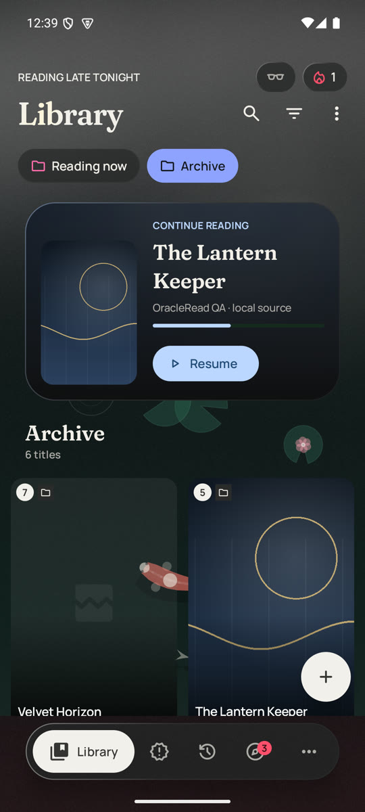
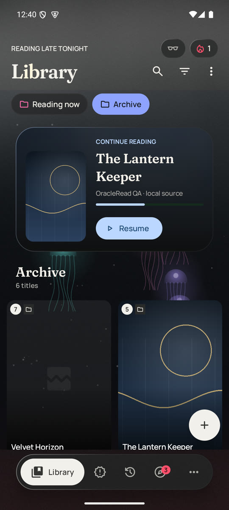
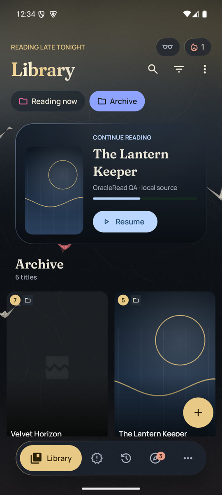
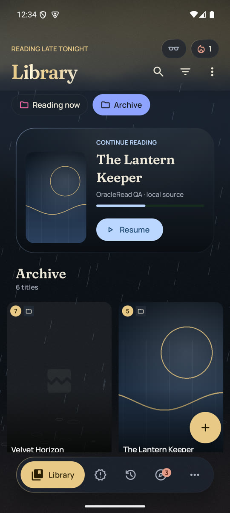
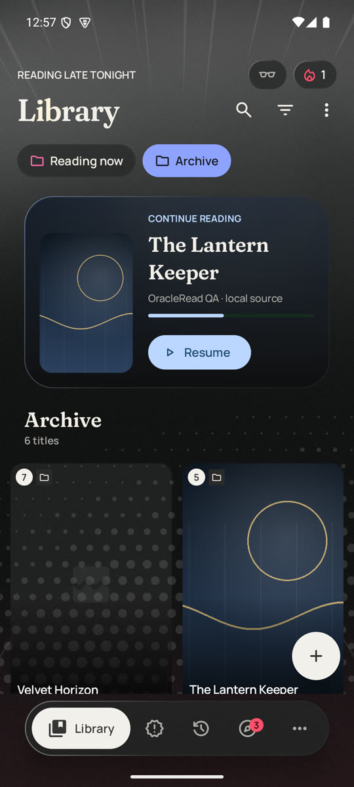
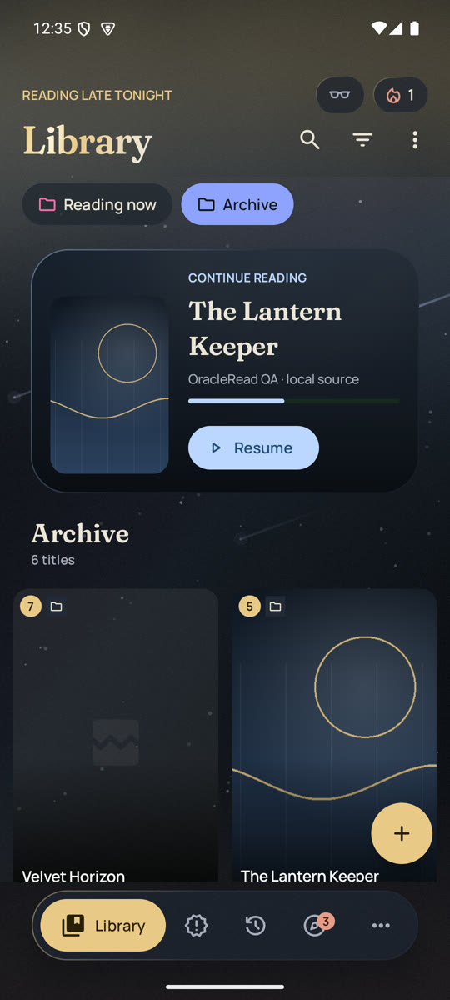
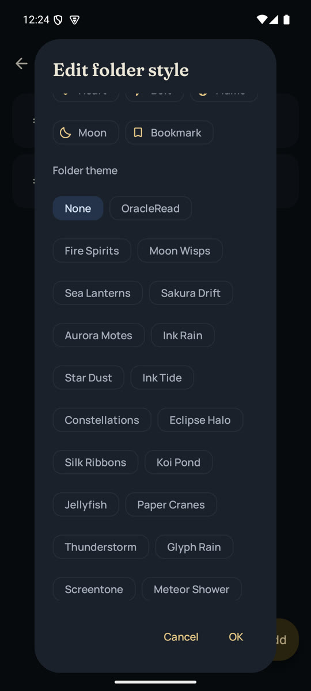

# OracleRead 1.4.2 (2026-10-29)

Six new themes, each with a background effect of its own, eight new folder backgrounds, a **Last read** button, and
reading that skips the chapters you've hidden.

**Updating:** 1.4.2 is signed with the same OracleRead key as 1.4.0 and 1.4.1, so it installs over either one and
keeps your library.

## What's new

| | |
|---|---|
| **Last read** | The button above Resume now opens the chapter you read most recently, at the page you left, whatever the list's sorting or filters. It replaces 1.4.1's Latest. |
| **Reading skips hidden chapters** | With **Hide decimal chapters** or **Hide duplicate chapters** on, the reader's next and previous chapter go straight past what the chapter list hides (for example 2 → 3 without 2.5, and one copy of chapter 4). The library's continue-reading button skips them too. |
| **Tap again to turn off** | In a folder's style, tapping the selected background again switches it to None. |
| **Six new themes** | Koi Garden, Abyssal Bloom, Paper Cranes, Tempest, Neon Alley and Screentone, each with its own dark and light colors and its own background effect. |
| **Eight new folder backgrounds** | Koi Pond, Jellyfish, Paper Cranes, Thunderstorm, Glyph Rain, Screentone, Meteor Shower and Fireflies. |
| **Themes show up right away** | Folders whose style you never changed now use the app theme's own background. Folders you styled keep their choice. |

## Themes

| Koi Garden | Abyssal Bloom | Paper Cranes | Tempest | Neon Alley | Screentone |
|---|---|---|---|---|---|
|  |  |  |  |  |  |

- **Koi Garden**: a moonlit pond. Koi with smooth, patterned bodies circle under drifting lily pads, ripples spread
  across the water and the moon's reflection shimmers.
- **Abyssal Bloom**: the deep sea at night. Bioluminescent jellyfish pulse upward in surges, trailing tentacles,
  through falling marine snow.
- **Paper Cranes**: washi paper on sumi ink. Folded cranes glide across on slow wingbeats, one folded from red seal
  paper.
- **Tempest**: slanting rain under soft, rolling cloud banks, splashes along the bottom, and every eight seconds a
  fork of lightning that lights the clouds from inside. The flash is soft and brief, well under photosensitivity
  limits.
- **Neon Alley**: magenta and cyan katakana rain, dimmed behind the header so its text stays readable.
- **Screentone**: a manga halftone that swells in waves from a corner, framed by breathing speed lines.

## Folder backgrounds

| Koi Pond | Jellyfish | Paper Cranes | Thunderstorm |
|---|---|---|---|
|  |  |  |  |

| Glyph Rain | Screentone | Meteor Shower | Fireflies |
|---|---|---|---|
|  |  |  |  |

| Last read above Resume | Decimals and duplicates hidden | Folder picker |
|---|---|---|
|  |  |  |

Screenshots use local test chapters with original procedural cover art. No hosted manga is included.

## Verification

- Formatting, database migration checks and all 168 unit tests pass. New tests cover hidden-chapter navigation,
  Last read, the tap-again toggle, theme effects, and every theme having its own colors and View style.
- All five APKs are signed with the OracleRead release certificate and report version 1.4.2 (1420):
  [v1.4.2-apks.json](v1.4.2-apks.json).
- Installed over 1.4.1 on an Android 15 emulator, with the library kept. Checked by hand there:
  - **Last read** opened the copy read most recently (Chapter 4, Group B) while Resume pointed at Chapter 3.
  - With both hide options on, the reader went 2 → 3 → 4 (Group A) → 5 and back again, skipping Chapter 2.5 and
    the other copy of chapter 4.
  - Tapping the selected Silk Ribbons again saved the folder as None.
  - Each theme and each new background was captured and reviewed.
- Performance: [performance.md](performance.md).

## Limits

- Emulator frame timings compare versions; they are not a promise for every phone.
- Library unread and progress counts still count every copy of a duplicated chapter, and decimal chapters.
- The manga page keeps its cover-derived accent, so it looks the same in every theme.

## Which APK?

Most phones need **arm64-v8a**. If you're not sure, use the universal `OracleRead-release-1.4.2.apk`.
